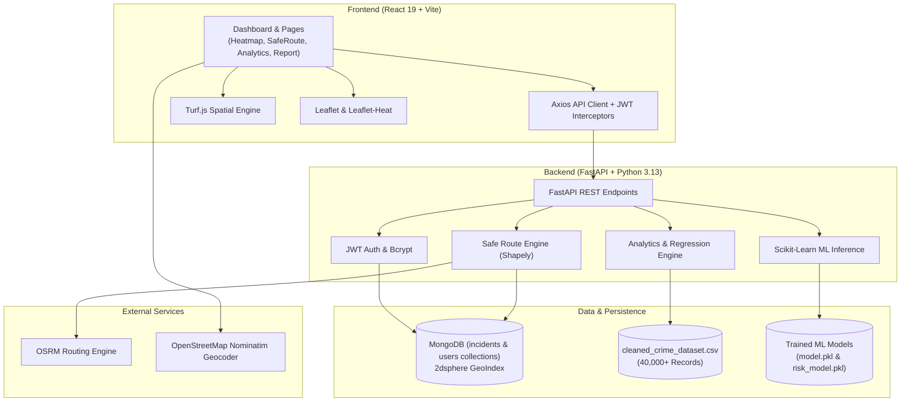

<div align="center">

# 🛡️ CrimeWatch AI

### *Intelligent Public Safety Platform, Predictive Crime Analytics & Safe Route Navigation*

[](https://fastapi.tiangolo.com/)
[](https://react.dev/)
[](https://vitejs.dev/)
[](https://tailwindcss.com/)
[](https://www.python.org/)
[](https://www.mongodb.com/)
[](https://scikit-learn.org/)
[](https://leafletjs.com/)

<p align="center">
  <b>CrimeWatch AI</b> empowers citizens and law enforcement with real-time geospatial crime visualization, AI-assisted incident reporting, predictive risk scoring, and intelligent crime-aware safe routing.
</p>

[Key Features](#-key-features) •
[System Architecture](#-system-architecture) •
[AI & Machine Learning](#-ai--machine-learning-models) •
[Tech Stack](#-tech-stack) •
[Project Structure](#-project-structure) •
[Getting Started](#-getting-started) •
[API Reference](#-api-endpoints-reference)

</div>

---

## 📌 Overview

Urban safety requires more than historical statistics—it requires actionable, real-time intelligence. **CrimeWatch AI** is a full-stack platform that bridges the gap between community vigilance and data science:

- **Visualize Risk:** Dynamically renders incident clusters and density heatmaps across geographical regions.
- **Navigate Safely:** Computes and compares walking and driving routes based on localized crime density, traveler profile, and time of day rather than solely looking at travel time.
- **Automate Incident Reporting:** Classifies user-submitted crime descriptions automatically using Natural Language Processing (NLP).
- **Forecast Crime Trends:** Employs predictive regression models and analytical aggregation to highlight risk levels, peak occurrence hours, and closure rates.

---

## ✨ Key Features

### 1. 🗺️ Interactive Crime Heatmap
- **Zoom-Aware Heat Rendering:** Dynamically calibrates heat radius and blur based on map zoom levels for crystal-clear regional and street-level insight.
- **Multi-Dimensional Filters:** Filter incidents in real time by:
  - **Severity Rating** (Level 1 to Level 5)
  - **Crime Category** (e.g., Theft, Robbery, Assault, Burglary, Homicide)
  - **Time Range** (Past 24 hours, 7 days, 30 days, 90 days, or All time)
- **Live Statistics & HUD:** Real-time counters showing total active points, high-risk ratios, and dominant crime types in view.

### 2. 🛡️ Crime-Aware Safe Route Engine
- **Address Autocomplete & Geocoding:** Instant search powered by the OpenStreetMap Nominatim engine.
- **Multi-Route Comparison:** Evaluates alternative travel routes calculated via the Open Source Routing Machine (OSRM) API.
- **Corridor Safety Scoring (0–100%):**
  - Uses [Turf.js](https://turfjs.org/) and [Shapely](https://shapely.readthedocs.io/) to sample points along the route corridor (300m buffer).
  - Queries MongoDB with spherical geospatial indexing (`$geoWithin` + `$centerSphere`).
  - Factor in **Severity Weights** (e.g., Homicide: 10, Assault: 7, Theft: 3).
  - Multipliers for **Time of Day** (Day: 1.0x, Evening: 1.2x, Night: 1.5x) and **Traveler Profile** (e.g., solo travel considerations).
- **Segmented Visual Polylines:** Visualizes routes in color-coded safety segments (Green for Safe, Amber for Moderate, Red for High Risk) with interactive crime markers along the route.

### 3. 📝 AI-Powered Incident Reporting
- **Smart Natural Language Classifier:** Users type incident details in plain English; a TF-IDF + Naive Bayes pipeline automatically predicts the crime category.
- **Interactive Multi-Step Form:** Clean step-by-step reporting with demographic options (victim age, gender, weapon used) and geo-coordinates.
- **Instant Database Integration:** Submitted incidents are saved with GeoJSON Point indexing and immediately reflected in heatmaps and safe route calculations.

### 4. 📊 Analytics & Predictive Forecasting
- **Linear Regression Forecasting:** Analyzes historical monthly incident counts and forecasts crime trends for upcoming months.
- **Temporal Patterns:** Breakdowns of incidents by **Time of Day** (Morning, Afternoon, Evening, Night) and **Day of the Week** (Monday through Sunday).
- **City & Severity Breakdowns:** Identifies top affected metropolitan areas, case resolution/closure rates, and distribution across severity tiers.
- **Interactive Visualizations:** Built with [Chart.js](https://www.chartjs.org/) and [Recharts](https://recharts.org/) with responsive dark-mode styling.

### 5. 💬 AI Safety Chatbot & Proximity Intelligence
- **Interactive CrimeWatch AI Chatbot:** In-dashboard assistant answering localized crime queries (e.g., "Nearby summary", "Top nearby areas", "Latest alerts").
- **10km Hyper-Local Proximity Intelligence:** Calculates immediate safety metrics, real-time alerts, and highest-risk nearby streets within a 10 km radius of the user's detected location.

### 6. 🔐 Authentication & Protected Access
- **Dual Authentication Support:** Sign-up and login utilizing JSON Web Tokens (JWT) with HS256 signature, bcrypt password hashing, and integrated Google OAuth 2.0 single sign-on.
- **Client Route Guards:** Seamless route protection preventing unauthorized access to sensitive dashboards.

---

## 🏛️ System Architecture



---

## 🤖 AI & Machine Learning Models

CrimeWatch AI integrates two specialized machine learning models located in `backend/src/`:

### 1. Crime Category Classifier (`model.pkl`)
- **Objective:** Automatically classify unstructured text descriptions into standardized crime categories (e.g., *Burglary*, *Assault*, *Robbery*, *Kidnapping*, *Identity Theft*).
- **Architecture:** 
  $$\text{Text Description} \xrightarrow{\text{TF-IDF Vectorizer (5,000 features, English stop words)}} \xrightarrow{\text{Multinomial Naive Bayes}} \text{Crime Category}$$
- **Output:** Categorical label + Top-5 predicted probability distribution.

### 2. Risk Score Regressor (`risk_model.pkl`)
- **Objective:** Predict localized risk magnitude (`Risk_Score`, `Risk_Level`, and `Risk_Percentage`).
- **Algorithm:** Random Forest Regressor trained on spatial, temporal, and demographic features:
  - **Spatial:** `Latitude`, `Longitude`
  - **Temporal:** `Crime_Hour`, `Crime_Month`, `Is_Weekend`
  - **Contextual:** `Severity`, `Victim Age`, `Victim Gender`, `Weapon Used`, `Weapon_Risk`
  - **Neighborhood Density:** `Area_Crime_Count`, `Area_Avg_Severity`
- **Output:** Numerical risk score, categorical risk badge (`Low`, `Medium`, `High`), and normalized risk percentile.

---

## 💻 Tech Stack

| Category | Technology | Description |
| :--- | :--- | :--- |
| **Frontend Framework** | [React 19](https://react.dev/) + [Vite](https://vitejs.dev/) | High-performance SPA with modern ES module tooling |
| **Styling & UI** | [Tailwind CSS](https://tailwindcss.com/) + [Framer Motion](https://www.framer.com/motion/) | Dark-mode design system with smooth micro-animations |
| **Mapping & Geospatial** | [Leaflet](https://leafletjs.com/), [React-Leaflet](https://react-leaflet.js.org/), [Leaflet-Heat](https://github.com/Leaflet/Leaflet.heat), [Turf.js](https://turfjs.org/) | Geospatial client rendering, spatial buffers, heat layers |
| **Data Visualization** | [Chart.js](https://www.chartjs.org/), [React-ChartJS-2](https://react-chartjs-2.js.org/), [Recharts](https://recharts.org/) | Trend charts, bar graphs, and doughnut analytics |
| **Backend Framework** | [FastAPI](https://fastapi.tiangolo.com/) + [Uvicorn](https://www.uvicorn.org/) | Asynchronous, OpenAPI-compliant Python web framework |
| **Database** | [MongoDB](https://www.mongodb.com/) + [Motor](https://motor.readthedocs.io/) | Asynchronous document store with `2dsphere` spatial indexing |
| **Machine Learning** | [Scikit-Learn](https://scikit-learn.org/), [Pandas](https://pandas.pydata.org/), [NumPy](https://numpy.org/), [Joblib](https://joblib.readthedocs.io/) | Model training, serialization, feature engineering, and inference |
| **Geospatial Processing** | [Shapely](https://shapely.readthedocs.io/) | Coordinate interpolation and line buffering on the server |
| **Authentication** | [Python-Jose](https://python-jose.readthedocs.io/) + [Passlib (Bcrypt)](https://passlib.readthedocs.io/) | JWT signing, verification, and salted password hashing |
| **Routing & Geocoding** | [OSRM API](http://project-osrm.org/) + [OSM Nominatim](https://nominatim.org/) | Real-world road routing and address searching |

---

## 📂 Project Structure

```text
CrimeWatch/
├── data/
│   └── cleaned_crime_dataset.csv       # Preprocessed crime records dataset (40k+ entries)
│
├── backend/
│   ├── src/
│   │   ├── main.py                     # FastAPI application setup, middleware, root routes
│   │   ├── db.py                       # MongoDB Motor asynchronous connection
│   │   ├── auth.py                     # User authentication endpoints (register, login, JWT)
│   │   ├── incidents.py                # Incident submission, listing, and heatmap points endpoint
│   │   ├── safe_route.py               # Crime-aware route scoring and OSRM integration
│   │   ├── analytics.py                # Statistical aggregations and regression forecasts
│   │   ├── ml_model.py                 # ML inference loader (Category & Risk predictors)
│   │   ├── ml_train.py                 # Model training pipeline (TF-IDF + Random Forest)
│   │   ├── model.pkl                   # Serialized category classification model
│   │   └── scripts/
│   │       ├── create_geo_index.py     # MongoDB 2dsphere index creator
│   │       ├── fix_all_coordinates.py  # Coordinates sanitizer script
│   │       └── run_analytics.py        # Offline analytics aggregation utility
│   ├── tests/
│   │   └── test_heatmap_filters.py     # Pytest test suite for heatmap endpoints
│   ├── requirements.txt                # Python backend dependencies
│   ├── requirements-dev.txt            # Development & testing dependencies
│   └── .env.example                    # Environment variable template
│
├── frontend/
│   ├── public/                         # Static assets (Leaflet CSS/JS)
│   ├── src/
│   │   ├── api/
│   │   │   └── axios.js                # Centralized Axios client & API module definitions
│   │   ├── components/
│   │   │   ├── FloatingStats.jsx       # Real-time HUD summary banner on heatmap
│   │   │   ├── HeatmapFilters.jsx      # Heatmap severity, category, and date filter modal
│   │   │   ├── HeatmapLegend.jsx       # Visual intensity indicator
│   │   │   ├── Navbar.jsx              # Navigation header with active state tracking
│   │   │   ├── ProfileMenu.jsx         # User session & logout menu
│   │   │   └── ProtectedRoute.jsx      # Client route auth guard
│   │   ├── pages/
│   │   │   ├── Dashboard.jsx           # Platform portal and quick statistics overview
│   │   │   ├── Heatmap.jsx             # Interactive Leaflet crime heat map
│   │   │   ├── SafeRoute.jsx           # Safe route pathfinding and analysis
│   │   │   ├── Analytics.jsx           # Graphical charts, city rankings, and forecasts
│   │   │   ├── Report.jsx              # Guided incident reporting wizard with NLP
│   │   │   ├── Login.jsx               # User login view
│   │   │   └── Register.jsx            # User registration view
│   │   ├── App.jsx                     # Route definitions & router setup
│   │   ├── main.jsx                    # React virtual DOM entrypoint
│   │   └── index.css                   # Tailwind styles and custom dark theme
│   ├── package.json                    # Frontend dependencies & scripts
│   ├── tailwind.config.js              # Tailwind CSS configuration
│   └── vite.config.js                  # Vite bundler configuration
│
├── how to run.txt                      # Quick start notes
└── README.md                           # Documentation root
```

---

## 🚀 Getting Started

Follow these instructions to get CrimeWatch AI up and running on your local machine.

### Prerequisites

Ensure you have the following installed:
- **Node.js** (v18.0.0 or higher) & **npm**
- **Python** (v3.10 to v3.13)
- **MongoDB** (running locally on port `27017` or a MongoDB Atlas URI)
- **Git**

---

### Step 1: Clone the Repository

```bash
git clone https://github.com/nitin-1328/CrimeWatch.git
cd CrimeWatch
```

---

### Step 2: Backend Setup

1. **Navigate to the backend directory:**
   ```bash
   cd backend
   ```

2. **Create and activate a virtual environment:**
   - **Windows (PowerShell):**
     ```powershell
     python -m venv venv
     .\venv\Scripts\Activate.ps1
     ```
   - **macOS / Linux:**
     ```bash
     python3 -m venv venv
     source venv/bin/activate
     ```

3. **Install dependencies:**
   ```bash
   pip install -r requirements.txt
   ```

4. **Configure Environment Variables:**
   Create a `.env` file in the `backend/` directory (you can copy `.env.example`):
   ```env
   MONGO_URI=mongodb://localhost:27017
   DB_NAME=crimewatch_db
   JWT_SECRET=your_jwt_secret_key_here
   API_PORT=8000
   ```

5. **Initialize Geospatial Indexing (Optional but Recommended):**
   Ensure MongoDB has geospatial index support enabled for spatial queries:
   ```bash
   python src/scripts/create_geo_index.py
   ```

6. **Train ML Models (If `model.pkl` is not present):**
   ```bash
   python src/ml_train.py
   ```

7. **Start the FastAPI Backend Server:**
   ```bash
   uvicorn src.main:app --reload --port 8000
   ```
   > 🚀 Backend will be running at `http://127.0.0.1:8000` (Interactive Swagger docs available at `http://127.0.0.1:8000/docs`).

---

### Step 3: Frontend Setup

1. **Open a new terminal window** and navigate to the frontend directory:
   ```bash
   cd frontend
   ```

2. **Install Node packages:**
   ```bash
   npm install
   ```

3. **Start the Vite development server:**
   ```bash
   npm run dev
   ```
   > 🌐 Frontend will be accessible at `http://localhost:5173`.

---

## 📡 API Endpoints Reference

### Authentication (`/auth`)
| Method | Endpoint | Description |
| :--- | :--- | :--- |
| `POST` | `/auth/register` | Register a new user account with hashed password |
| `POST` | `/auth/login` | Authenticate user and receive a JWT Bearer token |

### Incidents & Heatmap (`/incidents`)
| Method | Endpoint | Description |
| :--- | :--- | :--- |
| `POST` | `/incidents/report` | Submit an incident; auto-classifies category via NLP |
| `GET` | `/incidents/list` | Retrieve recent community-reported incidents |
| `GET` | `/incidents/heatmap` | Fetch geospatial crime points with severity weights and filters |

### Safe Routing (`/route`)
| Method | Endpoint | Description |
| :--- | :--- | :--- |
| `GET` | `/route/find` | Calculate route safety score using OSRM geometry & incident density |

### Analytics & Forecasting (`/analytics`)
| Method | Endpoint | Description |
| :--- | :--- | :--- |
| `GET` | `/analytics/monthly_trend` | Historical monthly incident counts + 3-month linear forecast |
| `GET` | `/analytics/top_cities` | Top 10 cities by total reported crime count |
| `GET` | `/analytics/category_stats` | Distribution of crimes by category |
| `GET` | `/analytics/time_stats` | Frequency of incidents by time of day (Morning/Afternoon/Evening/Night) |
| `GET` | `/analytics/day_stats` | Frequency of incidents by day of the week |
| `GET` | `/analytics/severity_stats` | Incident frequency grouped by severity scale (1–5) |
| `GET` | `/analytics/closure_rate` | Case resolution percentage for top cities |

### Machine Learning (`/predict`, `/model-info`)
| Method | Endpoint | Description |
| :--- | :--- | :--- |
| `POST` | `/predict/category` | Predict category from natural language text |
| `POST` | `/predict/risk` | Predict quantitative risk score, level, and percentile |
| `GET` | `/model-info` | Health check and metadata for loaded ML models |

---

## 🧪 Running Tests

To run the backend automated test suite with mongomock and pytest:

```bash
cd backend
pytest -v
```

---

## 🗺️ Roadmap & Future Enhancements

- [ ] **Real-time Mobile Push Alerts:** Integration with WebSockets / Firebase Cloud Messaging (FCM) for immediate danger zone proximity warnings.
- [ ] **Crowdsourced Hazard Verifications:** Upvote/downvote credibility mechanism for community-submitted incidents.
- [ ] **Multi-modal Transit Routing:** Expanding safe routing to include public transit (bus routes, subway stations, lighted walkways).
- [ ] **Deep Learning Crime Hotspot Detection:** Upgrading risk regression to spatial-temporal Graph Neural Networks (GNNs) or LSTMs.

---

## 📄 License

This project is licensed under the **MIT License** — feel free to use, modify, and distribute it for personal and educational purposes.

---

<div align="center">
  <sub>Built with ❤️ for safer neighborhoods and smarter communities.</sub>
</div>
